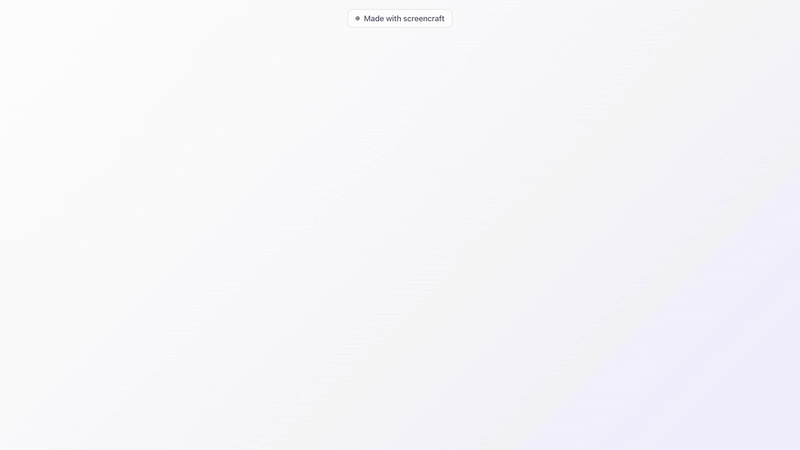

# screencraft

**Scriptable, open-source product videos of web apps with the look of a dedicated screen recorder:**
60 fps real footage, a camera that glides toward what matters, an oversized smooth cursor with click rings,
a rounded window on a wallpaper, subtitles and title cards. No GUI, no screen-recording permission,
no hand on the mouse. Rerun the script when the UI changes.



<sub>GIF preview at 15 fps. The real output is a 1920×1080, 60 fps MP4 — run `screencraft demo` to make it yourself.</sub>

```
scenario.py ──► screencraft record ──► footage/take.mp4 + events.json
plan.py     ──► screencraft compose ─► composition/ (HyperFrames project)
                screencraft render ──► video.mp4  (1080p60)
```

Independent, from-scratch implementation for the **web** (anything a Chromium page can show).
MIT licensed. Not affiliated with Screen Studio or any other recorder; no code or assets from them.

## Why

Tools like Screen Studio make demos look great, but every take is a human at the mouse, and every
UI change means recording again. screencraft keeps the look and makes the take a script:

| | screencraft | typical GUI recorder |
|---|---|---|
| Footage | real app, headless Chromium, 3840×2160 @ 60 fps | real screen |
| Cursor | logged and re-rendered: 56 px, press feedback, click ring | re-rendered |
| Camera | auto-zoom toward each click or any element, critically damped springs | auto-zoom on clicks |
| Stage | wallpaper, rounded window, inset frame, shadow | same idea |
| Text | subtitles, intro/outro cards, callouts, halos | captions, text layers |
| Repeatable | yes: scenario + plan in git, rerun in CI | no |
| Needs | Python, Node, ffmpeg | the app |
| Scope | web apps (for now) | any window |

## Quickstart

Requirements: Python 3.11+, Node 22+ (HyperFrames renders through `npx`), `ffmpeg` on PATH.

```bash
pip install git+https://github.com/dr-osmanovich/screencraft.git
playwright install chromium
screencraft demo              # records, composes and renders the bundled Notely app → out/demo/demo.mp4
```

`screencraft demo --skip-render` stops after capture and composition (about 40 s) if you only want to
look at the HyperFrames project.

## Use it with an AI coding agent

screencraft is built to be driven by agents (Claude Code, Codex, Cursor, …). The agent reads your app's
code, writes the scenario and plan, records, looks at stills, fixes, and renders.

```bash
npx skills add dr-osmanovich/screencraft      # installs the `screencraft` skill for your agents
```

Then ask, in the repo of your web app: *"Make a 20-second demo video of the sign-up flow with screencraft."*
The skill ([skills/screencraft/SKILL.md](skills/screencraft/SKILL.md)) tells the agent how to find a safe
demo state, script the take, check footage with `inspect`, review `snapshot` stills, and render. It also
explains how to pair with [/brag](https://github.com/latent-spaces/brag): brag writes the story and copy,
screencraft supplies the real footage.

Agent-friendly CLI: `--json` before any command prints one JSON result on stdout (progress on stderr);
`init` scaffolds `scenario.py` + `plan.py`; `inspect` lists marks and boxes; `doctor` checks dependencies
with fixes; `make` runs record → compose → check → render → poster in one call. Exit codes: 0 ok,
1 step failed, 2 bad input or missing dependency.

## Your own app

1. **Scenario** — the storyboard as actions. Marks name the beats, boxes tell the camera where things are.

```python
# scenario.py
CONFIG = {"base_url": "http://127.0.0.1:3000", "start_path": "/notes", "scale": 2}

def login(page, cfg):                       # optional
    page.goto(cfg["base_url"] + "/login")
    page.fill("input[name=email]", "demo@example.com"); page.fill("input[type=password]", "demo")
    page.click("button[type=submit]"); page.wait_for_load_state("networkidle")

def prepare(page, cfg):                     # optional: quiet the page
    page.add_style_tag(content=".toast{display:none!important}")

def run(take, page):
    take.mark("hook"); take.hold(0.8)
    tb = take.click("#entry", name="entry")                 # move, settle, press, release — all logged
    take.move(tb["x"] + tb["width"] * .8, tb["y"] + tb["height"] + 90, 0.4)   # park the pointer
    take.mark("type_start"); take.type("Planned the launch with the team.", cps=34); take.mark("type_end")
    take.click("#make", name="make"); page.wait_for_selector(".note"); take.mark("notes"); take.box("notes", "#notes")
    take.scroll_into_view("#archive", offset=300); take.mark("end")
```

2. **Plan** — camera, subtitles and cards, in footage seconds taken from the marks.

```python
# plan.py
def plan(ctx):
    m = ctx.m
    return {
        "intro": {"title": "Type once. <b>Notes</b> appear.", "subtitle": "Notely", "duration": 1.6},
        "outro": {"title": "Notely", "line": "Your day, in cards.", "duration": 3.2},
        "camera": [
            {"from": -99, "zoom": 1.0, "focus": "center"},
            {"from": m("type_start") - 0.8, "zoom": 1.6, "focus": ctx.center("entry", 0, 60)},
            {"from": m("type_end") + 0.25, "zoom": 1.55, "focus": "cursor"},
            {"from": m("notes") + 0.3, "zoom": 1.45, "focus": "notes"},
            {"from": m("end") - 3.0, "zoom": 1.0, "focus": "center"},
        ],
        "subtitles": [[m("type_start") - 0.3, m("type_end") + 0.2, "Write the day as one paragraph."]],
        "look": {"wallpaper": "violet", "accent": "#5444E6"},
    }
```

3. **Run** (`screencraft init video/` writes commented templates of both files)

```bash
screencraft record scenario.py --out out/footage
screencraft compose plan.py --footage out/footage --out out/composition
screencraft render out/composition --out out/video.mp4       # runs `hyperframes check` first
screencraft poster out/video.mp4 --at 9.0                     # bake a thumbnail as frame 0
# or all at once:
screencraft make scenario.py plan.py --out out --base-url http://127.0.0.1:3000 --poster-at 9
```

`screencraft snapshot out/composition --at 2,6,12 --out out/stills` gives PNG stills to review
before a render. Iterate on `plan.py` with `compose` alone; footage stays.

### Plan reference

| key | meaning |
|---|---|
| `camera` | list of `{from, zoom, focus}`; the last segment whose `from` ≤ t wins. `focus`: `"cursor"`, `"center"`, `[x, y]` (footage px) or a box name |
| `subtitles` | `[[start, end, text]]`; warns when shorter than 0.3 s per word or overlapping |
| `intro`, `outro` | title cards; `outro.logo` takes an image path, `outro.subtitle` a last subtitle |
| `callouts`, `halos` | annotations anchored in footage px / on a logged box |
| `music`, `sfx`, `key_sfx`, `click_sfx` | audio files copied into the composition; clicks and keystrokes come from the event log |
| `look` | `wallpaper` (`violet`, `mint`, `sunset`, `ocean`, `graphite` or any CSS background), `accent`, `radius`, `cursor_size`, `font`, `focus_omega`, `zoom_omega` |
| `tag` | small label pinned at the top (e.g. "Draft") |
| `video_start`, `media_start`, `video_end`, `cursor_end` | trims; defaults derive from the `hook` and `end` marks |
| `canvas`, `padding`, `fps` | 1920×1080, 5 %, 60 by default |

## How it works

Capture is Chrome DevTools `Page.startScreencast` from Playwright — frames only when the page
repaints, held for their real duration, assembled into constant 60 fps. The pointer is not recorded;
it is replayed from the event log. The camera is a plan of focus/zoom segments smoothed by
critically damped springs, evaluated as a pure function of time so HyperFrames can render frames in
any order. Details in [docs/how-it-works.md](docs/how-it-works.md); hard-won notes in
[docs/gotchas.md](docs/gotchas.md).

Measured on an Apple M1: 55–62 fps page repaint under capture with the default GPU flags
(about 30 fps without), a 20 s take records in under a minute, a 1080p60 render takes 4–5 minutes.

## Limits (today)

- Web only: whatever headless Chromium can render. Native apps need a real screen capture backend.
- macOS is the tested platform. Linux works without the Metal flags (lower repaint rate); Windows untested.
- Rendering depends on [HyperFrames](https://github.com/heygen-com/hyperframes) (Apache-2.0), fetched by `npx` on first use.
- One take, one video. Multi-take editing is a plan with several footage dirs — not yet.

## Roadmap

- Automatic camera plan from the event log (zoom to every click) when no plan is given.
- Native capture backend (ScreenCaptureKit / ffmpeg) for non-web windows.
- Cursor styles, typing cursor, keyboard overlay.
- Captions from a voice-over track.
- GIF/WebM/vertical presets.

## Credits

Built on [Playwright](https://playwright.dev), [HyperFrames](https://github.com/heygen-com/hyperframes)
and [GSAP](https://gsap.com). The spring camera was inspired by the HyperFrames registry component
`cursor-zoom-follow`. Screen Studio is a trademark of its owner; this project is an independent
implementation of the same idea and includes nothing from it.

## License

[MIT](LICENSE)
